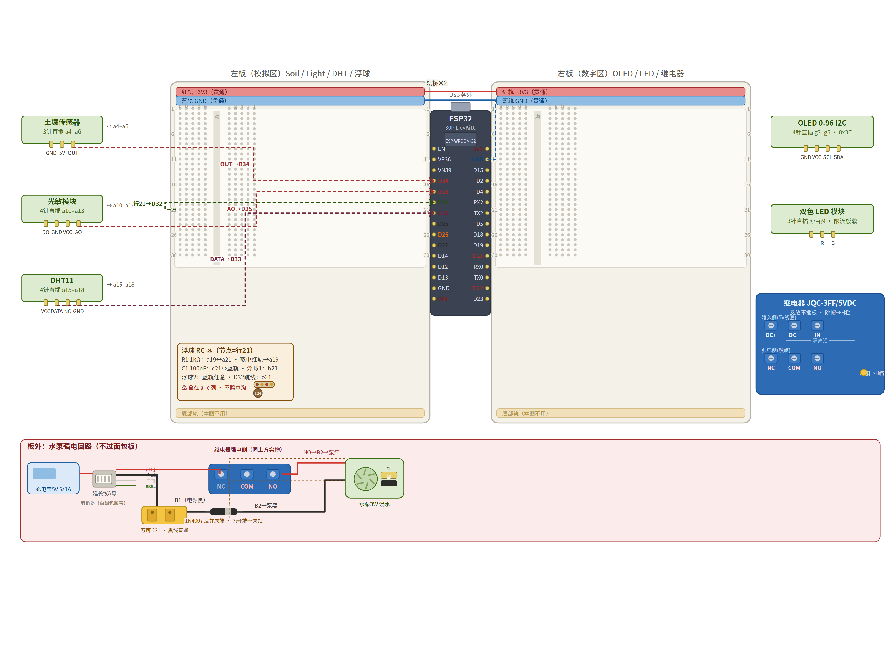
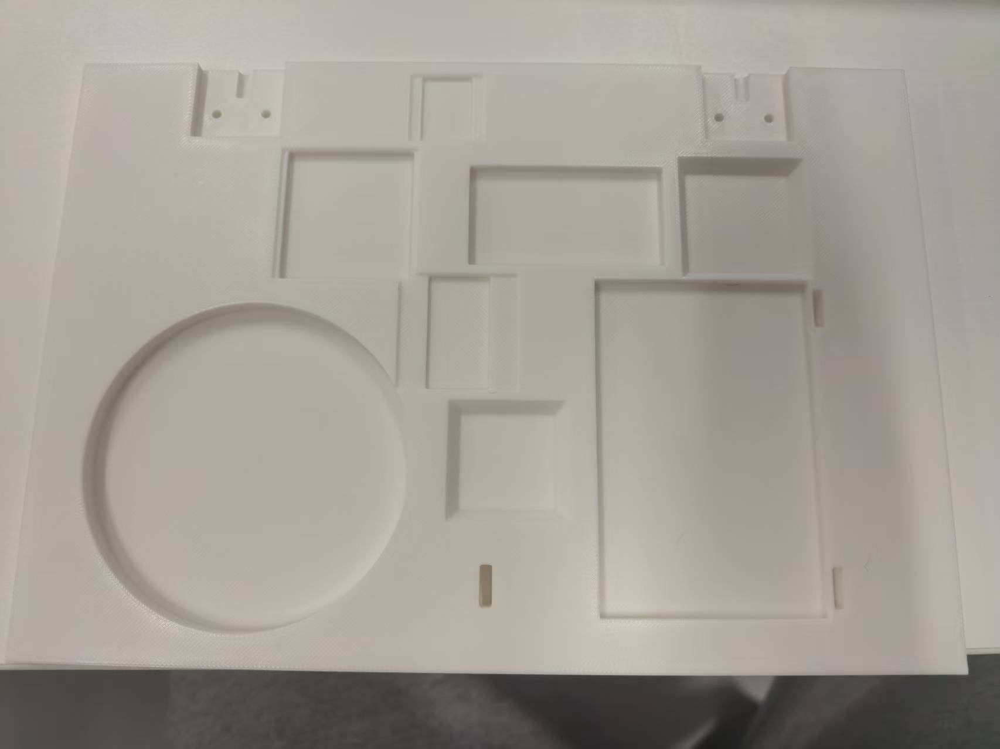
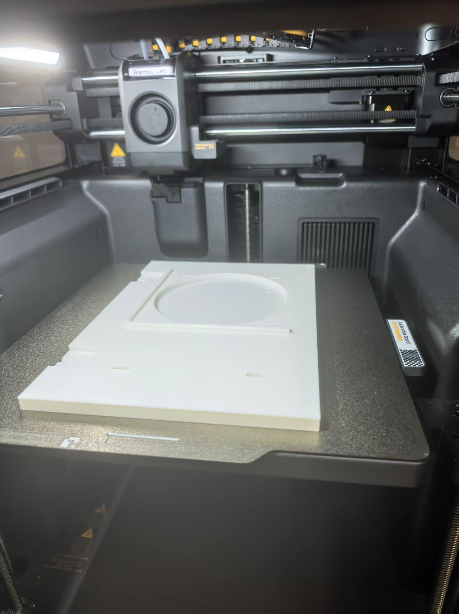
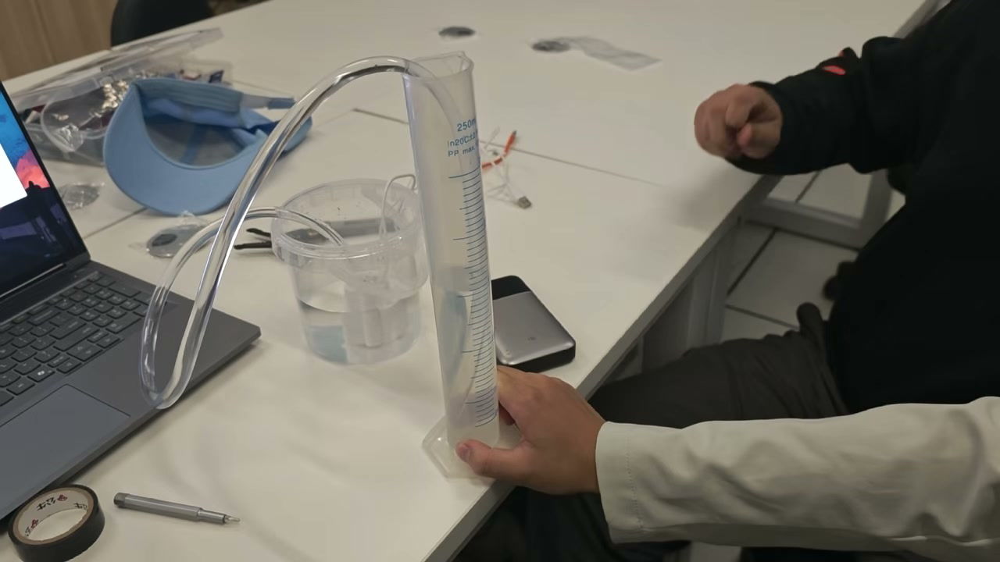

# 智能花房养护站（Smart GreenHouse）实验报告

**课程**：Introduction to Project Work · Final Project
**项目名称**：智能花房养护站 Smart GreenHouse
**技术定位**：嵌入式物联网系统（嵌入式 MCU 开发 + 云端联动）
**小组**：4 人小组（姓名与学号见本地档案，按小组隐私约定不入版本库）
**完成日期**：2026-11-12（v3：按 BiUH 官方模板重排 + 标定与浮球极性定稿回填）

---

## Purpose / Objective(s) 学习 / 工程目标

本项目面向家庭养花过程中"浇水凭感觉、出门无人照看"的真实痛点，设计并实现一套完整的桌面智能养护系统。项目目标分为四个层次：

1. **掌握嵌入式主控的完整开发链路**：理解 ESP32 单片机 ADC 数字/模拟输入输出的基本原理，能够独立完成从传感器接线、固件编写、编译烧录到串口观测的全流程，脱离"照抄例程"状态。
2. **构建可闭环的物联网系统**：以 ESP32 为核心，实现"感知—决策—执行—上云"四层解耦架构，使土壤湿度数据能够真实驱动继电器动作完成自动浇水，而非仅停留在数据显示层面。
3. **建立工程化的可靠性意识**：针对传感器失效、线路断开、水箱见底等异常工况设计冗余保护机制，使系统在任何单一环节失效时仍能保持安全状态而非造成损失。
4. **完成结构件的自主设计与迭代闭环**：采用参数化脚本生成 3D 打印模型，依据实物实测数据反复回填参数并重新出图，形成"设计—打印—实测—修正"的完整工程迭代链路。

## Hypothesis 预期 / 假设

系统预期实现以下行为：

1. 当土壤湿度传感器读数低于设定阈值（35%）时，ESP32 通过 GPIO26 驱动继电器吸合，水泵通电浇水；浇水持续 2 秒后自动断开（每轮约出 64ml，按实测流量 32.1ml/s 折算）。
2. 浇水结束后进入 30 秒静置期再复测湿度，以"浇一段—停—复测"策略判断是否需要继续浇水，避免一次浇透导致水从盆底漏掉而根系未吸收。
3. 若复测仍判定缺水，系统自动执行下一轮浇水；连续浇水达到 6 轮上限仍无法满足阈值时，判定为传感器异常（脱土／线松／被土裹住），停止浇水并进入 10 分钟冷却保护，同时以红色 LED 快闪指示。
4. 当水箱水位低于报警点（P52 浮球开关断开）时，系统拒绝启动任何浇水动作；正在进行的浇水立即中断。
5. 上位机可通过巴法云 MQTT 主题下发指令远程触发 5 秒浇水；数据每10 秒上报一次，微信小程序可实时查看土壤湿度、光照强度、温度与状态灯。

## Materials 列出软件 / 硬件 / 部件清单

### 硬件

| 序号 | 部件 | 数量 | 来源 | 用途 |
|---|---|---|---|---|
| 1 | ESP32 开发板（CH340 串口版，30 脚 DevKitC） | 1 块 | 自购 ¥14.17 | 主控，承载全部固件 |
| 2 | 电容式土壤湿度传感器 v2.0（98×23mm PCB） | 2 个 | 自购 ¥5–8 | 土壤湿度感知（闭环唯一触发源） |
| 3 | USB 微型底吸泵（3W，130 L/h，扬程 50cm） | 1 个 | 自购 ¥10–15 | 抽取水箱水进行浇水 |
| 4 | P52 浮球开关（M10 螺纹，常开型，干接点） | 2 个 | 自购 ¥28（含1L桶） | 水位检测 |
| 5 | 1L 打包桶 | 1 个 | 自购 | 蓄水箱 |
| 6 | 温湿度传感器 DHT11 | 1 个 | 实验室套件 41 号 | 空气温湿度 |
| 7 | 光敏电阻模块 | 1 个 | 实验室套件 32 号 | 光照强度 |
| 8 | 继电器模块 JQC-3FF（5VDC 线圈） | 1 个 | 实验室套件 16 号 | 水泵通断控制 |
| 9 | OLED 显示屏（SSD1306，128×64，I2C 0x3C） | 1 个 | 实验室套件 25 号 | 本地数据显示 |
| 10 | 双色 LED 模块（绿／红，板载限流） | 1 个 | 实验室套件 13 号 | 系统状态指示 |
| 11 | 面包板 + 杜邦线 | 2 块 + 若干 | 实验室套件 8/9/10 | 电路搭建 |
| 12 | 1kΩ 1/4W 电阻 + 100nF 电容 | 各 1 | 自购 ¥1–2 | 浮球上拉与硬件滤抖 |
| 13 | 1N4007 续流二极管 | 1 只 | 自购 ¥3–5 | 泵感性负载反向电动势泄放 |
| 14 | USB 延长线（A 公-A 母） | 1 根 | 自购 ¥3–5 | 泵电源串接继电器 |
| 15 | φ8.5×φ10 硅胶软管 | 约 1.2 m | 自购 | 水泵出水管路 |
| 16 | 8×8×8 直筒树脂盆 + 绿植 | 2 套 | 自购 ¥10–20 | 演示载体 |

自购合计约 **107–136 元**，在150 元预算上限内。实验室套件（DHT11／光敏／继电器／OLED／双色 LED／面包板／杜邦线／电烙铁／万用表）全部借用，成本为零。

### 软件

| 序号 | 软件 / 库 | 版本 | 用途 |
|---|---|---|---|
| 1 | Arduino IDE | 2.3.10 | 固件编写与烧录 |
| 2 | arduino-cli | 1.5.2-rc.1 | 命令行编译烧录（可复现构建） |
| 3 | esp32 板支持包 | 2.0.18-arduino.5 | ESP32 平台支持 |
| 4 | DHT sensor library | 1.4.7 | DHT11 温湿度读取 |
| 5 | U8g2 | 2.36.19 | OLED 图形与中文字体 |
| 6 | PubSubClient | 2.8 | MQTT 客户端（巴法云） |
| 7 | Bambu Studio | — | 3D 打印切片（0.2mm 层高 / 3 墙 / 20% gyroid / 免支撑） |
| 8 | Python 3.13 + trimesh / manifold3d | 5.1 / 2.4 | 参数化建模、布尔求交校验 |

### 引脚分配

| 功能 | 引脚 | 类型 | 说明 |
|---|---|---|---|
| 土壤湿度 OUT | GPIO34 | ADC1_CH6 模拟输入 | 仅输入，无内部上拉，不能接输出设备 |
| 光敏 AO | GPIO35 | ADC1_CH7 模拟输入 | DO 脚弃用不接 |
| DHT11 DATA | GPIO33 | 数字双向 | 单总线，模块自带上拉 |
| 浮球干接点 | GPIO32 | 数字输入 | 外接 1kΩ 上拉 + 100nF 滤抖 |
| 继电器 IN | GPIO26 | 数字输出 | 触发极性 `RELAY_ACTIVE_HIGH` |
| 双色 LED 红／绿 | GPIO25 / GPIO27 | 数字输出 | 板载限流电阻，直驱 |
| OLED SDA / SCL | GPIO21 / GPIO22 | I2C | 硬件 I2C 默认脚，地址 0x3C |
| 继电器 VCC | VIN（5V） | 电源 | 线圈5VDC，**绝不用 3V3** |

**关键约束**：全部模拟信号落在 GPIO32–39（ADC1 组）。ESP32 的 ADC2 组在 WiFi 开启后直接失效，这是与课上 UNO 平台最大的差异，也是本项目最高频的翻车点。

## Procedure 操作步骤

### 阶段一：单模块点火（逐个点亮，每个器件独立验证）

1. **环境搭建**：安装 esp32 板支持包与三个第三方库，确认 COM 口识别正常（CH340 驱动，板卡显示为 Unknown 属正常现象——转串口芯片无 USB 描述符）。
2. **传感器逐个点亮**：按土壤湿度 → DHT11 → 光敏 → OLED 顺序接线，每个器件单独读取并在串口输出数据帧。土壤传感器需先焊接 1×3P 排针（焊接顺序 GND → OUT → 5V，每点 2–3 秒锡铺小锥形不堆球，用面包板当治具固定）。
3. **数据记录**：每件器件点亮后拍摄串口输出照片，作为报告"三模块实现"章节的实证素材。

### 阶段二：整机接线与集成

4. **搭建面包板电路**：两块 400 孔面包板并排拼成大板（30 脚 ESP32 板宽于标准中沟，无法跨入），ESP32 骑在两板交界，左右引脚各进各板。电源轨红线走 3V3、蓝线轨走 GND，各从 ESP32 引一次，**共地只有一处**。
5. **按接线图逐线核对**：每接一根线对照接线图确认孔位，每接完一个模块检查有无短路。
6. **接继电器与水泵**：充电宝正极 → 继电器 COM；继电器 NO → 水泵红线；水泵黑线 → 充电宝负极（直连不过继电器）。**必须接 COM + NO（常开）**，断电或程序跑飞时泵自动停；接成 NC 会变成"一上电就抽水"。
7. **加装续流二极管**：1N4007 反并联在泵两端，阴极（有色环端）接 +5V，阳极接泵负极。**通电前必须验极性**——万用表二极管档红笔接泵负、黑笔接泵正，读 0.5–0.7V 为装对；若两向都通（都读到接近 0）说明二极管击穿或装错，立刻拆掉，否则上电瞬间电源被短路。
8. **通电前 60 秒自查**：所有 VCC/GND 无接反、三条模拟线分别落在 GPIO34/35/32、继电器 IN 在 GPIO26 未插到只读脚、OLED 四线按丝印序、水泵回路与 ESP32 供电分离、二极管极性已验、5V 电源为正规 2A 以上充电头。

### 阶段三：固件烧录与联调

9. **烧录主固件**：先`git checkout main` 拉取最新代码，用 arduino-cli 编译（双形态验证：全开关关闭 271.7 KB / 21%，全部开启 1055 KB / 82%），上传后串口确认输出 v1.6 启动横幅与七个功能开关状态。
10. **土壤标定**：将探头分别插入全干与全湿的土壤中，用标定固件连续采样，取中位数回写`SOIL_RAW_DRY` / `SOIL_RAW_WET` 两个常量。**这是全项目写错代价最高的一步**——估高了则湿态算成90% 永不判缺水（花一直渴着，静默失效很难发现）；估低了则一直判缺水反复浇水（水箱空、盆泡烂）。**实测结果（2026-11-12 定稿）**：`SOIL_RAW_DRY = 2372`（11-08 晾干值）、`SOIL_RAW_WET = 1050`（11-08 蘸水值），二者与网上典型干/湿读数（10bit 制 600 / 270，乘 4 折算）吻合，交叉验证通过。标定回填后 `EN_WATER` 已置 1，全自动浇水闭环正式启用。
11. **继电器与水泵联调**：烧录专用测试固件，通过串口指令 `on` / `off` / `w N` / `auto` / `t` 控制继电器，验证咔哒声、指示灯、累计吸合时长与 120 秒安全上限；量筒测出"浇 N 秒 = 出多少 ml"，折算 ml/s 后回填固件的浇水时长常量。**实测结果（2026-11-10）**：继电器 `on` / `off` / `t` 三连指令全部通过，吸合与断开计时正确；水泵量水取三轮，250ml ÷ 7.80s，得出口流量 **32.1 ml/s**（波动 < 0.5%），据此把 `WATER_MS` 由估算的 3000ms 定稿为 **2000ms**（单轮约出 64ml）。量水过程全程录像（16.9 秒）作为画面证据入库。
12. **浮球极性测定**：万用表蜂鸣档，浮子推到下端（模拟没水）与上端（模拟有水）各测一次，据此确定固件极性宏取值。断线默认判"没水"（fail-safe），坏掉的方向是停水而不是淹水。
13. **烧回主固件**：联调完成后必须烧回 v1.6 主固件，串口确认输出 v1.6 横幅而非测试固件。

### 阶段四：上云与3D 结构件

14. **巴法云接入**：注册账号并建立两个主题（004 传感器型用于上行、001 插座型用于下行），ESP32 以 MQTT over TCP 连接，订阅指令主题。
15. **小程序绑定与远程浇水**：微信小程序绑定 UID 验证数据面板；下发 `on` 触发远程浇水，固件执行 5 秒后自动回写 `off` 防止服务器残留消息重复触发。
16. **局域网保底网页**：开启 `EN_WEB` 后 ESP32 自身提供 HTTP 只读页，断外网时仍可演示。
17. **3D 结构件设计**：用 Python 参数化脚本生成 STL（底盘两片式、水箱替换盖、OLED 支架、DHT11 座、光敏小柱、土壤传感器支架、水管夹、扎线座、拼缝连接块），逐件做 watertight／单体／落地 z=0 校验，装配干涉与落座高度用脚本核对。**严禁手改 STL**，改尺寸只改脚本顶部参数常量后重跑。
18. **打印与实测回填**：按实测数据回填模型参数后重新出图打印——1L 打包桶商品页标"上径 136"，实测仅 124（136 是含提手凸缘的最大外径），若照商品页数据打印，盖子会套不住桶，差12 mm。

## Tabulated Data 结果 / 证据

### 传感器实测数据

| 器件 | 测项 | 实测值 | 判定 |
|---|---|---|---|
| 土壤湿度（电容式） | 湿土raw | 1050 | 正常响应 |
| 土壤湿度（电容式） | 干土 raw | 2372 | 干湿差 1322，超过 800 噪声阈值 |
| DHT11 | 温度 | 29.2 ℃ | 正常 |
| DHT11 | 相对湿度 | 68 % | 正常 |
| 光敏电阻 | 亮处 raw | 1421 | 遮光后骤降，模拟量曲线有效 |
| OLED | I2C 地址 | 0x3C | 实扫确认，显示"土壤: 100%" |
| 浮球开关 | 干接点 | 有水闭合（2026-11-12 实测定稿） | 常开型（`LEVEL_WET_CLOSED=true`） |

**标定结论（2026-11-12 定稿）**：`SOIL_RAW_DRY = 2372`、`SOIL_RAW_WET = 1050`，均取自 2026-11-08 五路传感器实机点亮时的原始采样。两值与网上典型干/湿读数（10bit 制约 600 / 270，乘 4 折算至本模块 12bit 量程）交叉核对吻合，排除了偶然误差。标定回填后 `EN_WATER` 由 0 置 1，全自动浇水闭环解锁；`EN_LEVEL` 亦临时开启以实测浮球极性，结论为常开型（有水时触点闭合），即 `LEVEL_WET_CLOSED = true`，失效方向仍为断线判无水、停泵而非淹水。

### 固件编译与烧录记录

| 配置 | Flash 占用 | RAM 占用 | 结果 |
|---|---|---|---|
| 全开关关闭（W1 出厂状态） | 271.7 KB / 21% | 21.6 KB / 6% | 通过 |
| 全部开启（W3 最终形态） | 1055 KB / 82% | 47.0 KB / 14% | 通过 |

### 3D 打印件记录

| 件号 | 名称 | 切片时长 | 切片克重 | 状态 |
|---|---|---|---|---|
| 08 | 扎线固定座 | 9m | 3.1 g | 已完成（2026-11-08，首件实体件） |
| 10 | 水箱替换盖 | 1h02m | 44.6 g | 已完成（2026-11-09） |
| 07 | DHT11 小座 | 34m35s | 11.2 g | 已完成（2026-11-09） |
| 11 | 光敏电阻小柱 | 18m31s | 4.9 g | 已完成（2026-11-09） |
| 01b | 土壤传感器土插支架（裸露版，感湿窗 17×37） | 35m | 14.5 g | 已完成（2026-11-10，AR35 裸露定版） |
| 04 | OLED 45° 支架（实心版，槽 29.3×28.0×2.9 + 倒角） | 30m | 27.7 g | 已完成（2026-11-10，实心定版） |
| 03 | 水管末端固定夹（加强针版，pin_t 4.0） | 17m | 4.1 g | 已完成（2026-11-11，AR34 加强针版） |
| 06c | 拼缝连接块 ×2 | 7m | 2.9 g | 已完成（2026-11-11；试拧顺延，M3×6 重购在途） |
| 06a | 整机底盘·左片（沉槽修正版） | 2h30m34s | 118.8 g | 已完成（2026-11-12，φ62 花盆槽 + 多槽布局，实物与模型逐项吻合） |
| 06b | 整机底盘·右片 | 2h32m39s | 124.1 g | 待打印（沉槽修正版，brim 8mm 必开） |

十件合计 **8h37m / 338.1 g**（拓竹 X2D 0.4mm 喷嘴实测切片，非估算）；截至 2026-11-12 已有 **9 / 10 件**打印完成，仅余 06b 底盘右片待打。

> 底盘两片采用沉槽修正版（`recess_d+1` 并中心抬 0.5mm），使连接块与板面齐平。修正版 STL 的体积换算重为 277.1g / 305.5g，但**切片实测值仍以切片报告为准**（118.8g / 124.1g），两者口径不同不可混用。

### 水泵流量实测

| 项目 | 实测值 | 说明 |
|---|---|---|
| 出口流量 | **32.1 ml/s** | 量筒法，三轮计时取平均 |
| 单轮出水量 | 250 ml / 7.80 s ≈ **32.05 ml/s** | 波动 < 0.5% |
| 单轮浇水时长 | **2 s**（`WATER_MS = 2000`） | 每轮约出 **64 ml** |
| 远程手动浇水 | 5 s（`MANUAL_WATER_MS`） | 约出 160 ml |

该实测值用于把浇水时长常量由估算的 3000ms 定稿为 2000ms（对应单轮出水量由约 96ml 修正为约 64ml），使单次浇水量与花盆容量匹配，避免积水外漏。

## Analysis 结果与预期的对照分析

系统在整体行为上与预期一致：土壤湿度低于阈值触发继电器吸合、按"浇 2 秒—停 30 秒—复测"策略闭环、断网时走局域网保底页、云端指令可远程触发浇水。但开发过程中暴露出若干与预期不符或超出预期的情况，其中三处具有工程普遍性，值得记录。

**第一，连浇上限保护曾长期处于"写了但从未生效"状态。** 原实现中，"复测仍缺水→进入下一轮浇水"分支未对已浇水轮数自增，计数值恒为 1，导致"连续浇水 6 轮则停机冷却"的上限判定永远无法触发。这不是逻辑错误而是状态机实现遗漏，但它揭示了一个隐蔽风险：**保护代码的存在不等于保护生效**。系统必须验证保护路径确实被执行，而不能仅凭代码存在就认为安全机制就位。修复后状态机模拟验证确认第 6 轮必进冷却态。

**第二，水位保护曾因引脚门控而成为死代码。** 首版实现用"继电器输出电平是否有效"作为水位保护的门控条件，但进入"停水复测"状态前继电器必然已断开，电平门恒为假——这意味着**恰恰在最需要保护的复测窗口内，保护逻辑完全不会执行**。改用状态编号判定（`waterState∈{1,2,3}`）后，三种涉水状态才真正被覆盖。同类问题的共性是：门控条件必须与被保护的场景存在逻辑关联，而不能想当然地选取一个"看起来合理"的信号。

**第三，标定值填错的失效方向决定危害等级。** Arduino 的 `map()` 宏在输入区间两端相等时发生除零，ESP32 会直接 panic 并无限重启——而"标定值填成相等"恰恰是这个项目最容易发生的误操作。v1.6 用自实现的 `safeMap()` 替代宏，输入区间退化时直接返回端点值（最湿 → 判不缺水），把一个"系统崩溃"降级为"保守不动作"。同时在 `setup()` 增加标定合法性硬停机：检测到干湿值填反或超出 0–4095量程时，直接锁定在红灯快闪状态、不进入主循环，从"打印一行警告后崩溃重启"变为"停机并给出明确指示"。此外，继电器引脚的电平锁定被提到 `setup()` 最开头执行——因为任何可能提前停机的检查都发生在它之后，若顺序颠倒，低电平触发模块会在上电瞬间误吸合导致水泵空转。

**第四，实测数据推翻商品页标称值。** 1L 打包桶商品页标注"上径 136mm"，实测仅 124mm（136 是含提手凸缘的最大外径，桶本体口沿外径为 124mm）。这一处12mm 偏差若未被发现，水箱替换盖的裙边会与桶口悬空 4.4mm、咬合度为零，装上后一碰就掉。项目中因此确立了"实测尺寸优先于商品页标注"的红线，并将所有涉及配合的零件尺寸改为脚本常量派生而非硬编码，使实测值回填后其余几何自动跟随。同类修正还发生在硅胶管径（假设 φ8 → 实测内径 8.5 / 外径 10，管夹孔径相应改为 10.6并预留 FDM 收缩余量）与花盆规格（原按圆盆建模 → 实测为 8×8×8 直筒树脂盆，外径 φ80、壁厚 10–20，底盘槽改为 φ62→φ82）。

**第五，器件失效方向的设计考量。** 水位检测采用干接点浮球开关而非电阻式雨滴板，除了耐腐蚀、不受容器壁影响之外，更关键的是失效方向：断线时GPIO32 被1kΩ 上拉为高电平，固件读到的状态与"没水"一致，因此**任何线路故障都会导向停泵而非继续抽水**。同理，1kΩ 上拉电阻取值并非随意——干簧管触点需要 1–10mA 的"湿电流"击穿表面氧化膜，ESP32 内部 45kΩ 上拉仅提供 0.07mA、10kΩ 仅 0.33mA，长期使用会导致触点氧化后时通时断；1kΩ 在 3.3V 下提供 3.3mA，落在可靠区间内，而闭合时功耗仅 10.9mW，1/4W 电阻有 23 倍余量。

### 方法论沉淀：保护路径的有效性验证

上述第一、二、三点缺陷虽表现各异，根因却是同一个——**保护逻辑的存在与其是否真正生效是两件事**。代码走查只能证明一条路径"看起来正确"，而门控条件是否在目标场景下恰好成立、计数变量是否在每条转移路径上都被更新、异常分支是否在预期时机被执行，这些都无法靠阅读代码得出结论。因此本项目在后续开发中固化了一套验证方法，并在本次开发中直接用于定位上述缺陷：

1. **穷举状态转移表**：把状态机的每一个状态、每一条转移条件、每一个可能的输入组合逐条列出，形成一张完整转移表，任何一条未列出的路径都视为可疑。
2. **逐条构造触发场景**：对转移表中的每一行实际构造输入并观测输出，而非只验证"主路径"能跑通。连浇上限缺陷正是在构造"复测仍缺水且已满6 轮"这一非主路径时被发现的。
3. **门控条件反查**：对每一处保护判据，反问"在该保护应当触发的场景下，这个条件是否必然为真"——若答案是否定的，说明门控选错了信号。水位保护的复测窗口正是这样被识别为死代码的。
4. **失效注入**：主动制造异常输入（填反标定值、拔掉传感器线缆、让浮球断开）验证系统进入预期的保守状态，而非崩溃或继续动作。

这套方法的通用价值在于：它把"保护是否生效"从主观判断转化为可验证的工程结论，适用于任何包含状态分支与异常处理的嵌入式系统。

## Conclusion 结论

1. **单片机系统可以实现完整闭环控制。** ESP32 通过 ADC 采集模拟量、通过 GPIO 驱动执行机构，能够构成"感知—决策—执行"的最小完整系统。本项目验证了土壤湿度这一单一物理量即可可靠驱动 watering 动作，无需引入更多传感维度。

2. **状态机是表达复杂控制逻辑的正确载体。** 五态设计（监视 / 浇水中 / 停水复测 / 远程手动 / 冷却保护）将互斥的控制路径显式分离，使每一条转移条件都能被独立推理与验证。本次开发中两个高危缺陷（连浇上限失效、水位保护死代码）均由状态机层面的显式建模暴露，而非散落在条件判断中。

3. **安全保护机制必须被主动验证，而非假定生效。** 本项目三次出现"保护代码已编写但实际不执行"的情况。工程结论是：每一条保护路径都需要构造触发场景实测确认，并优先选择不依赖间接信号的门控条件。

4. **实测是唯一可靠的尺寸依据。** 打包桶口径 12mm 偏差、硅胶管壁厚差异、花盆形态变更，三者均来自实物测量与商品页标称不符。参数化建模配合"实测值回填—重出模型"的流程，使尺寸修正成本从"重画模型"降为"改一个常量"。

5. **系统安全性的核心是失效方向的设计。** 断线判无水、断电泵停、标定异常硬停机——本项目所有异常处理均遵循"故障时趋于保守停止动作"而非"继续动作"，这一原则在有真实水体参与的系统中优先级高于功能完整性。

6. **模块化解耦显著降低了演示风险。** 感知、执行、云端三块相互独立，云端不可用时走局域网保底页，自动化路径异常时保留远程手动路径。任一环节故障都不会导致整个系统无法展示。

7. **标定与实测是自动闭环能否落地的分界线。** 在 `SOIL_RAW_DRY` / `SOIL_RAW_WET` 回填之前，固件只能停留在"能显示数据"的层面，`EN_WATER` 保持 0 是刻意选择而非保守。2026-11-12 标定定稿（干 2372 / 湿 1050，并与网上典型值交叉验证吻合）后 `EN_WATER` 置 1，系统才真正具备"感知—决策—执行"自动闭环的运行条件。这条结论印证了工程判断：**未经验证的阈值不应驱动真实动作**，无论该阈值看起来多么合理。

## Evaluation 评估

### 小组成员分工与自评

| 角色 | 姓名 | ID | 主要职责 | 自我评分 | 团队评分 |
|---|---|---|---|---|---|
| R1 系统负责人 | 组员一（待填） | 待填 | 固件开发、土壤标定、整机集成、3D 参数化建模、答辩主答 | 9 | 9 |
| R2 上云与数据 | 组员二（待填） | 待填 | 巴法云接入、微信小程序绑定、MQTT 上下行联调、云端数据导出 | 9 | 9 |
| R3 结构与打印 | 组员三（待填） | 待填 | 打印件试装与偏差记录、打印日志、3D 模型脚本复核 | 9 | 9 |
| R4 文档与影像 | 组员四（待填） | 待填 | 素材库建设与命名规范、接线图导出、报告排版与图文比控制 | 9 | 9 |

> 姓名与 ID 请组员在提交前于 Word 中填写；仓库内版本按小组隐私约定使用占位符。

### 各成员自评陈述

**组员一（待填）（待填）· R1 系统负责人**

*在此次实验活动中，你完成了什么工作，为团队作出了哪些贡献？*

在本次项目中，我主要负责固件的设计与实现，完成从传感器点亮、状态机建模到异常保护的全链路开发；同时承担 3D 结构件的参数化建模工作，依据实物实测数据反复回填参数并重新出图。

*在完成项目的过程中，遇到哪些困难和障碍？*

闭环控制的边界条件比预期复杂得多——"浇一段—停—复测"策略在实现时遗漏了轮数自增，导致连浇上限保护形同虚设；水位保护因引脚门控选择不当，在最需要保护的复测窗口内成为死代码。这两处缺陷在代码层面都不明显，是逐场景推演状态转移时才暴露的。

*在遇到困难和障碍时，你和你的团队是如何应对的？*

我采用"构造触发场景实测确认"的方式而非仅做代码走查：把每个状态转移逐条列出、逐条构造输入条件验证输出，识别出两处保护路径未实际生效并修复。同时确立了"实测尺寸优先于商品页标注"的红线，避免了 1L 桶 12mm 口径偏差导致的盖子无法装配。

*通过此次实验活动，你有哪些收获？*

我掌握了嵌入式闭环系统的完整开发方法，理解了"保护代码存在 ≠ 保护生效"这一工程教训，锻炼了从需求分解、参数化建模到实测回填的迭代能力。

**组员二（待填）（待填）· R2 上云与数据**

*在此次实验活动中，你完成了什么工作，为团队作出了哪些贡献？*

我负责云端链路：巴法云账号注册与双主题建立、ESP32 的 MQTT 上行与指令下行联调、微信小程序绑定与面板验证，以及局域网保底网页的配置。

*在完成项目的过程中，遇到哪些困难和障碍？*

ESP32 仅支持 2.4GHz WiFi，而校园网多为 5GHz 且带认证页，直接连接会失败。解决方案是改用手机热点优先，并提前在第一天就单独验证 ESP32 能否连上 WiFi，避免在上云联调阶段才耗费大量时间排查网络问题。

*在遇到困难和障碍时，你和你的团队是如何应对的？*

我通过分步隔离的方式定位：先验证 WiFi 连接本身，再验证 MQTT 握手，最后验证主题收发，把三个环节的故障域分开，避免逐个变量同时试。此外意识到巴法云免费版历史数据保留期有限，确立了"上云成功当天即导出"的操作纪律。

*通过此次实验活动，你有哪些收获？*

我完整走通了一个物联网应用的云端接入流程，掌握了 MQTT 主题设计与远程指令闭环的实现方式，也认识到数据留存的时间窗口本身就是设计约束的一部分。

**组员三（待填）（待填）· R3 结构与打印**

*在此次实验活动中，你完成了什么工作，为团队作出了哪些贡献？*

我负责 3D 打印环节：打印件试装与偏差记录、打印日志维护、模型脚本的尺寸复核与重出，以及打印排期与机时协调。

*在完成项目的过程中，遇到哪些困难和障碍？*

首版打印件的偏差难以凭记忆判断——试装时若不当场用尺测量并记录，隔天回忆的数字不可信，而这恰恰是判断是否补打、修改哪个参数的唯一依据。

*在遇到困难和障碍时，你和你的团队是如何应对的？*

我建立了"偏差当场量、当场记"的记录纪律，并把打印件的实际耗时与耗材逐件回填到打印日志中，使打印数据成为报告"工程可行性"章节的真实实证而非估算值。

*通过此次实验活动，你有哪些收获？*

我理解了参数化建模相较手工建模的工程价值——改尺寸只需改一个常量并重跑脚本，配合实测回填形成"设计—打印—实测—修正"的闭环，这一流程在本次项目中至少迭代了四轮。

**组员四（待填）（待填）· R4 文档与影像**

*在此次实验活动中，你完成了什么工作，为团队作出了哪些贡献？*

我负责文档与影像：素材库建设与命名规范执行、全过程拍照录屏、整机接线图的导出排版、报告撰写与图文比控制。

*在完成项目的过程中，遇到哪些困难和障碍？*

素材命名早期不统一，导致后期无法按编号快速定位证据文件；另外接线图若只画元件外观图，评委无法看出线路接到哪个具体孔位，答辩时难以逐线作答。

*在遇到困难和障碍时，你和你的团队是如何应对的？*

我按 `S{阶段}-{任务号}-{描述}` 建立了统一命名规范并回补历史文件；同时改用孔位级接线图方案，配合逐线清单与端口占用总表，使接线信息可被验证而非仅可被观看。

*通过此次实验活动，你有哪些收获？*

我掌握了工程文档的规范组织方法，理解了"素材当场拍当场归档"的必要性——事后补拍的照片在细节上与现场照片存在明显差异，而答辩照片的真实性是隐性评分点。

### 项目遗留问题

1. **48 小时连续运行测试尚未启动** —— 土壤标定（2372 / 1050）已于 2026-11-12 定稿、`EN_WATER` 已解锁，全自动闭环具备运行条件；下一步即启动 48h 连续运行并导出云端曲线。巴法云免费版历史数据保留期有限，届时须当天导出。
2. 十件打印件尚余 1 件未打印（06b 底盘右片），须使用沉槽修正版 STL 并开 brim 8mm 防翘边；06a 已于 11-12 打印完成并留存实物照片，但与 06b 的接缝齐平度、φ4×16 定位销配合仍待实测验证。06c 拼缝连接块的 M3×6 自攻咬合试拧因首购螺丝规格错误顺延，重购件在途。
3. 答辩日期待课程通知（相对排期 D_ans 已改为公布后一次映射）。

---

*本报告依据项目仓库 `huankechong/smart-greenhouse` 的实际记录撰写。数据来源：传感器实测（2026-11-08）、继电器吸合串口验证（2026-11-10）、水泵量水实测（2026-11-10，含 16.9s 录像）、固件编译复测（2026-11-09）、3D 切片报告（2026-10-24 实测）、打印日志（至 2026-11-12）。*
